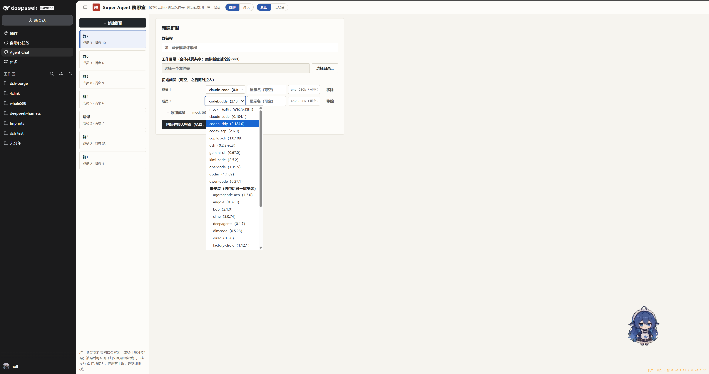
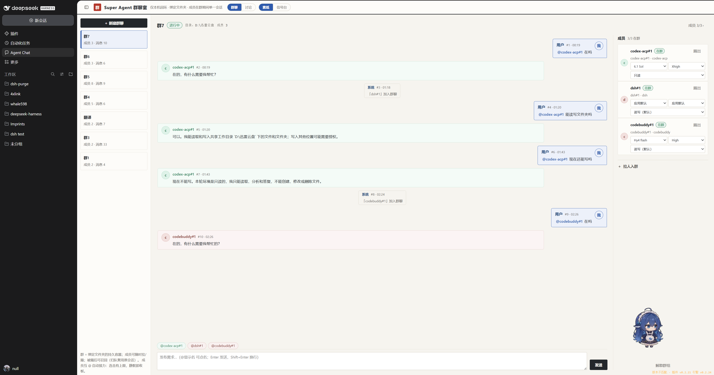
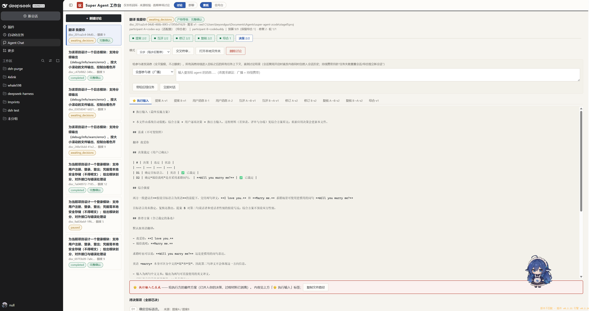
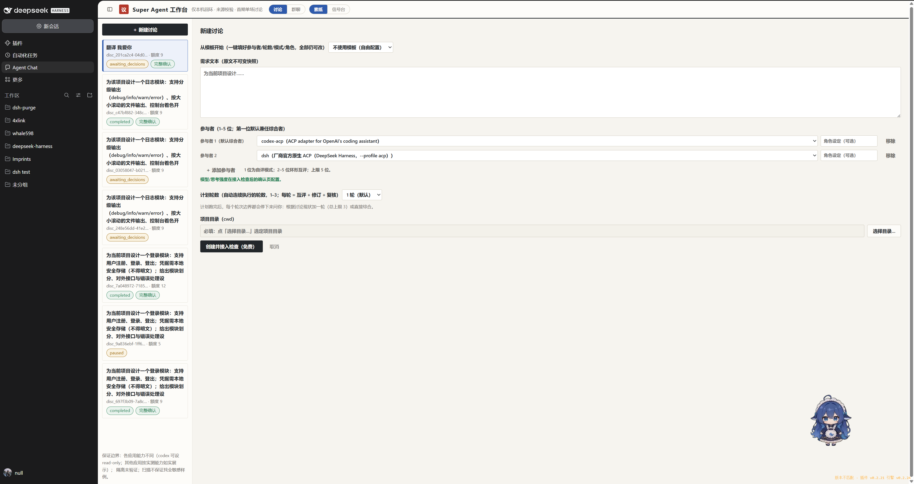

# dsh-agent-chat

把 Super Agent 的群聊与讨论接入 DSH（DeepSeek Harness）的 cordis 插件。
薄插件：不嵌引擎源码、不改 Super Agent 架构；宿主半侧是本机 workbench 的
代理 + 可选模型工具面，UI 经 `/wb` 通道整体复用。

> 开发者向的仓库结构 / 本地部署 / 发布流程 / 故障排查见 [DEVELOPMENT.md](DEVELOPMENT.md)。

## 功能

- **侧栏板面（主体）**：DSH 侧边栏 Agent Chat 图标 → 单一 iframe 指向插件自持的
  `/dsh-agent-chat-598/shell` 容器页（tab 栏 + 群聊|讨论 两个常驻内层 iframe，经 /wb
  代理复用 workbench 完整 UI）；**面板切换停靠保活**（选中/滚动/草稿/轮询全保留），
  tab 态记 localStorage。板面内即完整工作台能力：群聊室的成员档位（模型/思考强度/
  读写模式）、拉人/归队、讨论的阶段流水线 + 预算账本 + 决策导出
- **安装/登录引导**：应用下拉区分已安装/未安装（registry 驱动）——选中未安装项出现
  精确版本一键安装卡，装完出现登录窗口（可见终端，OAuth 在终端完成）；群聊与讨论
  两处表单同款
- **连接自愈**：workbench 死亡/重启时面板自动退避重连（1s→15s），恢复后自动回到
  原状态 + 绿横幅；常驻 iframe 切走时轮询降频 30s
- **原生目录对话框**：`选择目录…` 经 DSH 顶层主帧桥（插件 client 直调 preload 暴露的
  `__DSH_DIRECTORY_PICKER__` → Electron 主进程 dialog）弹系统对话框；桌面版走自身
  host hook，独立浏览器形态回退网页选择器
- **模型工具面（默认关）**：`config.tools: true` 时注册 5 个零生命周期 agent 工具
  （`super_groups_list/post/board` + `super_disc_list/detail`）并同步 agent-chat skill；
  **默认关闭**——先满足 UI 面板使用，工具面后续迭代；关闭时自动回收历史同步的 skill
- **`agentChatApi` cordis 服务**：其他插件可在宿主半侧 `ctx.get('agentChatApi')` 复用同一客户端

## 安装

- **npm 渠道**：包 `dsh-agent-chat`（[npmjs](https://www.npmjs.com/package/dsh-agent-chat)）——
  包 = 插件壳（~47kB），**引擎不在包里**，首次打开面板自动从 GitHub Releases 下载（SHA256 校验，
  面板显示进度）；市场按下载量展示（repository 字段已指回本仓库，关联自动采集）
- **GitHub 源码**：clone 后 `npm run build`（构建需同级私有仓库 `super-agent-zcode`，缺失时
  自动跳过引擎 bundle → 走首启下载），经 `dsh plugin add` 安装
- 引擎生命周期决策顺序：

| 顺序 | 条件 | 动作 |
|---|---|---|
| 1 | 探测到存活实例（桌面版 / CLI / 先前引擎，portfile + pid 存活校验） | 直接复用，不重复拉起 |
| 2 | 无存活实例且有捆绑副本（开发/离线形态） | 自动拉起捆绑引擎（DSH 自带 node，动态端口 + portfile 握手） |
| 3 | 无捆绑副本（npm/CI 形态） | 首启下载：Releases artifact → SHA256 → `~/.dsh/cache/dsh-agent-chat/<version>/` 后拉起 |
| 4 | 下载失败 | 引导横幅给出原因与桌面版安装建议 |

- 引擎随 DSH 生命周期：DSH 关闭时自动回收（数据落盘无损）；引擎进程是**子进程**，
  崩溃不连坐；与桌面版/CLI 经 portfile pid 校验互斥共存
- **真适配器（codex-acp / codebuddy 等）不随插件分发**：需要用户自己的账号认证（业界
  惯例，同 Zed）。未安装的在应用下拉分组展示，选中可一键安装（npm 精确版本），装完
  引导登录

## 上游发现（Super Agent workbench 在哪）

按顺序取第一个命中的：

1. 环境变量 `SUPER_WORKBENCH_UPSTREAM`（如 `http://127.0.0.1:7980`）
2. portfile：`<SuperAgent 数据目录>/workbench.port`（workbench 启动时写入 JSON
   `{port, pid, version, startedAt}`，pid 存活才采信；数据目录默认 `%USERPROFILE%\Documents\SuperAgent`）
3. 插件配置 `upstream`
4. 默认 `http://127.0.0.1:7980`

HTTP 路由前缀 `/dsh-agent-chat-598`：后缀 598 是个人命名空间标记（与 `~/.dsh` 的
whale598 / persona-presets-598 同一约定）；cordis bundle id 全局唯一，前缀本不会撞。

## 架构（两个仓库）

```
DSH 桌面版（cordis 宿主）
 └─ dsh-agent-chat 插件（本仓库，公开）
     ├─ host: /shell 容器页 + /wb UI 复用代理 + /api 反代（同源防线）+ 引擎拉起/首启下载
     │        + 模型工具面（默认关）+ native-pick 顶层主帧桥
     └─ client: 单一 iframe + 停靠保活 + 目录对话框桥
          │  HTTP（portfile 发现）
          ▼
Super Agent（私有仓库 super-agent-zcode）
 ├─ packages/orchestrator   ← 群聊引擎 + 讨论引擎（全部业务逻辑）
 ├─ packages/workbench      ← HTTP API + 全部 UI
 └─ apps/desktop            ← Electron 桌面版（同一套 workbench）
```

耦合面只有 **HTTP 契约**（REST API 形状 + 页面 DOM 结构）；改产品去私有仓库，
改"怎么嵌进 DSH"去本仓库。

## 截图

| | |
|---|---|
|  |  |
|  |  |

## 开发

```sh
npm install
npm run build          # tsdown（host ESM + client IIFE）+ esbuild 引擎 bundle + public/ 拷贝
npm test               # node --test（上游发现 / apply 冒烟 / 路由 / 引擎 / 下载校验）
npm run typecheck      # tsc --noEmit
npm run deploy         # typecheck + test + build + verify-deploy（profile 副本字节比对+硬链接自愈）
npm run pack:artifact  # dist/engine-artifact.zip + SHA256 清单（引擎发布产物）
npm run publish-engine # gh release create/upload（发布引擎二进制；源码仍私有）
```

- 引擎 bundle 打包需要私有仓库 `super-agent-zcode` 在同级目录（构建机）；缺失时
  自动跳过引擎部分（CI 形态：公开仓库只构建/测试插件本体）
- 本地部署：`npm run deploy` 后重开 DSH 生效；workbench 静态资源改动热部署后整页 F5
- npm 发布走 CI（`.github/workflows/publish.yml`，需 NPM_TOKEN secret）——流程与坑见
  [DEVELOPMENT.md](DEVELOPMENT.md) §4.3

## 收录与分发

- [awesome-dsh-plugin](https://github.com/awesome-dsh-plugin/awesome-dsh-plugin) 收录 PR
  [#16034](https://github.com/awesome-dsh-plugin/awesome-dsh-plugin/pull/16034)（workflow 分类，
  双语条目 + 截图条目）
- npm：`dsh-agent-chat@0.2.26`（latest）；引擎 artifact 随版本发布（v0.2.24/25/26）
- 引擎分发 = PyLance 模式：公开插件壳 + 私有引擎源码 + Releases 二进制产物

## 当前状态（v0.2.26 · npm latest）

- 已实测：双适配器（codex-acp + codebuddy）创建群 ~30s 接入；引擎自动拉起、portfile
  握手、面板自愈、首启下载（真实 Releases E2E）；成员读写模式档位（协议级硬护栏 +
  提示词软边界，中途可切、切回自动回设）；原生目录对话框（顶层主帧桥）；npm 上架 +
  CI 发布通道就绪
- 已知边界：
  - 真适配器冷启动 25~30s 属正常（创建请求超时已放宽到 90s）
  - npm 包不含引擎：首次打开面板需联网下载（离线机器建议 Super Agent 桌面版，插件会
    经 portfile 自动发现）
  - npm 已发布的 0.2.26 仍注入工具面；GitHub main 已默认关，下一版本（0.2.27）对齐
  - 模型工具面默认关（`config.tools: true` 开启），当前先满足 UI 使用
  - dsh 的 ACP 侧未广播 modes → dsh 成员的只读档位为提示词软约束（诚实标注；
    发现是动态的，dsh 未来实现 modes 会自动升级为硬护栏）
  - npm 版本列表中的 `0.0.0-stage` 是首次发布的 staged 占位残留（无害，待清理）
